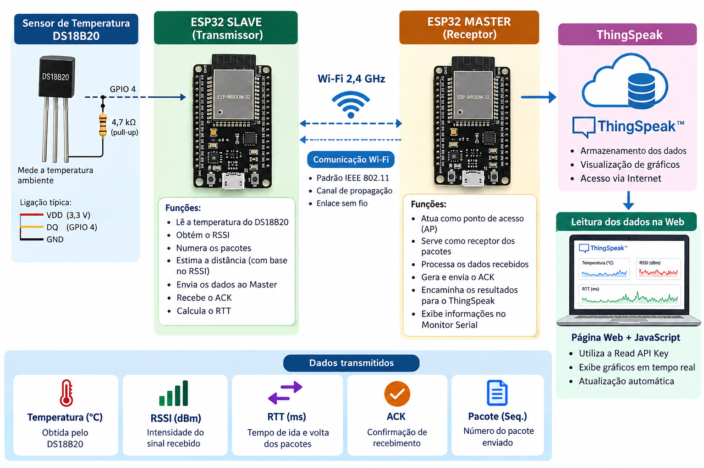

# Bancada Didática de Enlace Wi-Fi com ESP32 e ThingSpeak

## Descrição do projeto

Este projeto implementa uma **bancada didática para análise experimental de parâmetros de transmissão em um enlace sem fio Wi-Fi**, utilizando dois microcontroladores ESP32: um transmissor (**Slave**) e um receptor (**Master**).

O sistema permite estudar a **intensidade do sinal recebido (RSSI)**, o **tempo de ida e volta de uma mensagem (RTT)**, a **confirmação de recebimento (ACK)**, a **estimativa de distância** e a transmissão de dados de temperatura medidos pelo sensor **DS18B20**.

O Slave coleta as informações e as transmite ao Master por uma conexão TCP sobre Wi-Fi de 2,4 GHz. O Master responde com um ACK, recebe o RTT calculado pelo Slave e envia periodicamente os dados à plataforma **ThingSpeak** por HTTPS, utilizando sua API REST.

## 1. Arquitetura e arquivos do projeto



A bancada utiliza dois módulos ESP32 com funções distintas:

- **ESP32 Slave:** transmissor dos dados;
- **ESP32 Master:** receptor, ponto de acesso e gateway;
- **DS18B20:** sensor responsável pela aquisição da temperatura;
- **ThingSpeak:** plataforma utilizada para armazenamento e visualização dos dados;
- **Página Web:** interface para apresentação dos gráficos e indicadores do enlace.

Os firmwares principais são `slave006amqtt.ino` e `master006amqtt.ino`.

O fluxo geral de funcionamento é:

```text
DS18B20
   |
   v
ESP32 Slave / Transmissor
   |
   | Wi-Fi 2,4 GHz (TCP, DATA / ACK / RTT)
   v
ESP32 Master / Receptor
   |
   +---- Monitor Serial
   |
   v
ThingSpeak (HTTPS / API REST)
   |
   v
Página Web + JavaScript
```

## 2. Código Slave: `slave006amqtt.ino`

**Função principal:** realizar a aquisição e a transmissão dos dados experimentais do enlace.

### Funcionalidades

1. **Sensor DS18B20:** utiliza as bibliotecas `OneWire` e `DallasTemperature` para obter a temperatura pelo GPIO 4.
2. **Conexão Wi-Fi:** conecta-se à rede `ESP32_Transmission_Line` criada pelo Master.
3. **Medição de RSSI:** utiliza `WiFi.RSSI()` para ler a intensidade do sinal recebido, em dBm.
4. **Estimativa de distância:** calcula uma distância aproximada a partir do RSSI, com um modelo de perda de propagação.
5. **Contagem de pacotes:** incrementa um número sequencial a cada tentativa de transmissão de dados.
6. **Transmissão TCP:** conecta-se ao Master no endereço `192.168.4.1`, porta `80`, e envia a mensagem `DATA`.
7. **Verificação do ACK:** aguarda uma confirmação com o mesmo número do pacote.
8. **Cálculo do RTT:** mede o tempo entre o envio da mensagem e a chegada da resposta ACK, utilizando `millis()`.
9. **Comunicação do RTT:** quando o ACK é válido, envia ao Master uma segunda mensagem contendo o RTT calculado.
10. **Tratamento de erros:** registra falhas do sensor, tempo esgotado do ACK, erro de confirmação ou falha de conexão TCP.

### Estimativa de distância

O firmware utiliza a expressão:

$$
d=10^{\frac{RSSI_{1m}-RSSI}{10n}}
$$

Em que:

- **`d`**: distância estimada, em metros;
- **`RSSI_1M`**: valor de referência do RSSI a 1 metro, configurado como **−59,3 dBm**;
- **`RSSI`**: intensidade do sinal medida;
- **`n`**: expoente de propagação, configurado como **2,0**, correspondente ao modelo ideal de espaço livre.

A distância obtida é **uma estimativa**, não uma medição geométrica precisa. Obstáculos, interferências, reflexões e orientação das antenas podem alterar o RSSI.

### Exemplo de transmissão

```text
DATA,25,29.50,-59,0.97
```

| Campo | Significado |
|---|---|
| `DATA` | Tipo da mensagem. |
| `25` | Identificador sequencial do pacote. |
| `29.50` | Temperatura em °C. |
| `-59` | RSSI em dBm. |
| `0.97` | Distância estimada em metros. |

O Master responde, por exemplo:

```text
ACK,25
```

Quando o Slave valida a confirmação, pode transmitir:

```text
RTT,25,7
```

Isso indica que o tempo medido entre o envio de `DATA` e a chegada do ACK foi de **7 ms**. O Slave aguarda até aproximadamente **2 segundos** pela resposta e aplica um `delay(3000)` ao final de cada ciclo, além do tempo de leitura e processamento.

### Saída serial do Slave

```csv
Pacote,Tempo(ms),Temperatura(C),RSSI(dBm),Distancia(m),RTT(ms),ACK
25,123456,29.50,-59,0.97,7,OK
```

O campo `Tempo(ms)` é o valor de `millis()` do próprio Slave, e não um horário de relógio. Os estados possíveis no último campo incluem `OK`, `TIMEOUT`, `ACK_ERROR` e `CONNECTION_ERROR`. Nas falhas sem RTT válido, o código registra `-1`.

## 3. Código Master: `master006amqtt.ino`

**Função principal:** receber os dados, confirmar a recepção e encaminhar informações à plataforma ThingSpeak.

### Funcionalidades

1. **Rede Wi-Fi:** configura o ESP32 em modo `WIFI_AP_STA`.
2. **Ponto de acesso:** cria a rede `ESP32_Transmission_Line`, utilizada pelo Slave.
3. **Acesso à Internet:** estabelece conexão com um roteador externo, usando credenciais configuráveis.
4. **Servidor TCP:** inicializa `WiFiServer(80)` e aguarda conexões do Slave.
5. **Recepção dos pacotes:** interpreta as mensagens `DATA` e extrai o número do pacote, temperatura, RSSI e distância estimada.
6. **Confirmação:** envia `ACK,<pacote>` imediatamente após interpretar um pacote válido.
7. **Recepção do RTT:** espera até aproximadamente **1 segundo** pela mensagem `RTT` e verifica se ela corresponde ao pacote recebido.
8. **Registro serial:** apresenta os dados em formato CSV para acompanhamento e análise.
9. **Envio à nuvem:** faz uma requisição `HTTPS GET` para a API do ThingSpeak.
10. **Controle de atualização:** publica o registro mais recente quando há dados novos e decorreu um intervalo mínimo de **20 segundos** desde o último envio registrado.

### Organização dos campos do ThingSpeak

| Campo | Variável | Unidade / interpretação |
|---|---|---|
| Field 1 | Temperatura | °C |
| Field 2 | RSSI | dBm |
| Field 3 | Distância estimada | m |
| Field 4 | Número do pacote | Contador sequencial |
| Field 5 | Tempo de recepção | `millis()` do Master, em ms |
| Field 6 | RTT | ms |
| Field 7 | ACK | `1` para RTT válido do pacote; `0` quando não confirmado |

O valor `1` no Field 7 indica que o Master recebeu a mensagem de RTT correspondente ao pacote. Quando não recebe essa segunda mensagem corretamente, registra `0`, mesmo que tenha enviado o ACK.

A transmissão é realizada com `HTTPClient` e `WiFiClientSecure`, utilizando o endpoint:

```text
https://api.thingspeak.com/update
```

### Saída serial do Master

```csv
Pacote,Tempo(ms),Temperatura(C),RSSI(dBm),Distancia(m),RTT(ms),ACK
25,123458,29.50,-59,0.97,7,OK
```

O campo `Tempo(ms)` corresponde a `millis()` no **Master** no instante de recepção. Assim, os relógios relativos de Master e Slave não devem ser interpretados como uma mesma base de tempo sincronizada.

## 4. Sequência de comunicação

```text
ESP32 Slave                              ESP32 Master
     |                                        |
     |---- DATA,25,29.50,-59,0.97 ---------->|
     |                                        | Interpreta os dados
     |<----------------------------- ACK,25 --|
     | Calcula RTT = 7 ms                     |
     |-------------- RTT,25,7 -------------->|
     |                                        | Valida pacote e RTT
     |                                        | Registra no monitor serial
     |                                        | Publica no ThingSpeak
     |                                        | (quando permitido pelo intervalo)
```

O RTT é medido na camada de aplicação: engloba processamento e comunicação TCP, e **não** corresponde apenas ao tempo de propagação das ondas eletromagnéticas.

## 5. Comparação entre os códigos

| Característica | Slave | Master |
|---|---|---|
| Papel | Transmissor | Receptor e gateway |
| DS18B20 | Faz a leitura | Recebe a temperatura |
| RSSI | Mede | Recebe |
| Distância | Estima | Recebe |
| RTT | Calcula | Recebe e registra |
| ACK | Verifica | Envia |
| Operação Wi-Fi | Station (`WIFI_STA`) | AP + Station (`WIFI_AP_STA`) |
| Comunicação local | Cliente TCP | Servidor TCP, porta 80 |
| ThingSpeak | Não publica | Publica via HTTPS |
| Monitor serial | Transmissões e erros | Recebimentos e publicações |

## 6. Materiais e dependências

**Hardware:**

- Dois módulos ESP32 (por exemplo, DOIT DevKit V1 / ESP32-WROOM-32);
- Um sensor de temperatura DS18B20;
- Resistor pull-up de **4,7 kΩ** entre o sinal de dados do DS18B20 e a alimentação adequada;
- Cabos de ligação, alimentação USB e computador;
- Roteador Wi-Fi com Internet, para a publicação no ThingSpeak.

**Software e bibliotecas:**

- Arduino IDE com suporte às placas ESP32;
- `WiFi.h`;
- `OneWire.h` e `DallasTemperature.h` (Slave);
- `math.h` (Slave);
- `HTTPClient.h` e `WiFiClientSecure.h` (Master);
- Conta e canal configurado no ThingSpeak.

## 7. Configuração e execução

1. Instale o suporte à placa ESP32 e as bibliotecas necessárias na Arduino IDE.
2. Conecte o DS18B20 ao ESP32 Slave utilizando o **GPIO 4** para dados e um resistor pull-up de **4,7 kΩ**.
3. No arquivo `master006amqtt.ino`, configure `wifiSSID`, `wifiPassword` e `writeAPIKey` com os dados do roteador e a **Write API Key** do canal ThingSpeak.
4. Verifique se o SSID e a senha do ponto de acesso são iguais nos dois programas: `ESP32_Transmission_Line` e `password123` (valores de demonstração presentes no código).
5. Grave o firmware Master em um ESP32 e inicie-o primeiro, verificando a criação do ponto de acesso.
6. Grave o firmware Slave no outro ESP32 e verifique a conexão com o Master.
7. Abra o monitor serial de cada placa em **115200 baud** para acompanhar os registros.
8. Confira o recebimento dos pacotes e os campos configurados no painel do ThingSpeak.

> **Segurança:** não publique senhas reais de Wi-Fi nem chaves privadas de escrita do ThingSpeak em um repositório público. Substitua os valores de demonstração antes do uso.

## 8. Cuidados e limitações

- **Nome do protocolo:** apesar do sufixo `mqtt`, o firmware utiliza **TCP + HTTPS/REST**, não MQTT.
- **Distância estimada:** é derivada do RSSI e depende da calibração e das condições ambientais.
- **RTT:** mede o ciclo de comunicação na aplicação, incluindo atrasos de processamento e rede.
- **Intervalo de envio:** embora os pacotes do Slave sejam gerados com um intervalo aproximado de 3 segundos, o Master só envia ao ThingSpeak quando há dados novos e o intervalo mínimo de 20 segundos é satisfeito. **Nem todos os pacotes são necessariamente publicados na nuvem.**
- **Ausência total de pacotes:** se o Slave deixar de transmitir, pode não haver novos registros no ThingSpeak. Uma supervisão externa pode identificar essa situação pelo tempo decorrido desde a última atualização.
- **Validação TLS:** o Master chama `secureClient.setInsecure()`, desabilitando a validação do certificado HTTPS. Essa escolha deve ser revista em aplicações de produção.
- **Limites de espera:** o Slave aguarda até 2 segundos por ACK; o Master espera até aproximadamente 1 segundo pela mensagem RTT.
- **Confiabilidade do ACK:** o estado `1` no Master depende do recebimento de uma mensagem RTT válida, e não apenas da transmissão do ACK pelo Master.

## 9. Aplicações didáticas

A bancada pode ser utilizada em aulas e experimentos sobre:

- Redes sem fio IEEE 802.11 e aplicações de Internet das Coisas (IoT);
- Intensidade do sinal, atenuação e influência de obstáculos;
- Variação do RSSI com a distância e a orientação das antenas;
- Latência, RTT e confiabilidade da comunicação;
- Comunicação cliente-servidor com TCP;
- Confirmação de recebimento e falhas de comunicação;
- Aquisição de dados com sensores e armazenamento em nuvem;
- Análise de séries temporais experimentais.

## 10. Descrição para artigo científico ou relatório

Os códigos desenvolvidos para os microcontroladores ESP32 implementam uma arquitetura de comunicação sem fio composta por um transmissor (Slave) e um receptor (Master), utilizando a tecnologia Wi-Fi IEEE 802.11 na faixa de 2,4 GHz. O transmissor realiza a aquisição de temperatura por meio do sensor DS18B20, mede a intensidade do sinal recebido (RSSI), estima a distância entre os dispositivos e transmite pacotes identificados sequencialmente. A confiabilidade e a latência da comunicação são avaliadas por meio de mensagens de confirmação (ACK) e da medição do tempo de ida e volta (RTT). O receptor opera simultaneamente como ponto de acesso Wi-Fi e estação conectada à Internet, recebendo e processando os dados experimentais. As informações são registradas no monitor serial e encaminhadas


## Exemplo prático e atividade em sala de aula: estimativa de distância pelo RSSI

### 1. Objetivo da atividade

Compreender como a intensidade do sinal recebido (RSSI) pode ser utilizada para estimar a distância entre dois módulos ESP32 em um enlace Wi-Fi de 2,4 GHz.

A atividade permite relacionar conceitos de propagação eletromagnética, atenuação do sinal e comunicação sem fio, utilizando os dados obtidos pela bancada didática.
 
### 2. Modelo matemático

O ESP32 Slave utiliza um modelo de propagação para estimar a distância entre os dispositivos a partir da intensidade do sinal recebido (RSSI).

A distância é calculada pela expressão:

$$
d = 10^{\frac{RSSI_{1m}-RSSI}{10n}}
$$

Em que:

- **d:** distância estimada, em metros;
- **RSSI₁ₘ:** intensidade do sinal de referência a 1 metro, igual a −59,3 dBm;
- **RSSI:** intensidade do sinal medida pelo ESP32, em dBm;
- **n:** expoente de propagação, configurado como 2,0 para o modelo ideal de espaço livre.

### 3. Exemplo numérico resolvido

**Situação-problema:**

Durante um experimento com a bancada didática, o ESP32 Slave registrou uma intensidade do sinal recebido de **−65 dBm**.

Determine a distância estimada entre o ESP32 Slave e o ESP32 Master.

**Passo 1: identificar os parâmetros**

- RSSI de referência = −59,3 dBm;
- RSSI medido = −65 dBm;
- Expoente de propagação = 2,0.

**Passo 2: substituir os valores na fórmula**

$$
d = 10^{\frac{-59,3-(-65)}{10\cdot 2}}
$$

**Passo 3: simplificar a expressão**

$$
d = 10^{\frac{5,7}{20}}
$$

$$
d = 10^{0,285}
$$

**Passo 4: calcular a distância estimada**

$$
\boxed{d \approx 1,93\ \text{m}}
$$

**Resultado:** considerando RSSI igual a −65 dBm, a distância estimada entre os dois ESP32 é de aproximadamente **1,93 metro**.

**Observação:** o valor calculado representa uma estimativa matemática. A distância real pode ser diferente devido a interferências, obstáculos, reflexões e orientação das antenas.

 
### 4. Atividade proposta aos alunos

**Situação experimental:**

Durante uma aula prática de telecomunicações, os alunos deverão analisar diferentes intensidades de sinal recebidas pelo ESP32 Slave.

Considerando os parâmetros RSSI₁ₘ = −59,3 dBm e n = 2,0, calcule a distância estimada para cada medição apresentada na tabela.

| Medição | RSSI (dBm) | Distância estimada (m) |
|---|---:|---|
| 1 | −60 | A calcular |
| 2 | −65 | A calcular |
| 3 | −70 | A calcular |
| 4 | −75 | A calcular |
| 5 | −80 | A calcular |

**Orientações:**

1. Aplicar a equação de estimativa de distância para cada valor de RSSI.
2. Registrar os resultados na tabela.
3. Construir um gráfico relacionando RSSI e distância estimada.
4. Identificar o comportamento do sinal com o aumento da distância.
5. Comparar os resultados matemáticos com as medições realizadas na bancada experimental.

 

### 5. Atividade experimental com os ESP32

Organize a bancada com os dois módulos ESP32 em um ambiente com visada direta.

Posicione os dispositivos a distâncias conhecidas de 1, 3, 5 e 10 metros. Para cada distância, registre o RSSI medido e calcule a distância estimada utilizando o modelo de propagação.

| Distância real (m) | RSSI (dBm) | Distância estimada (m) | Erro absoluto (m) |
|---:|---|---|---|
| 1 | A medir | A calcular | A calcular |
| 3 | A medir | A calcular | A calcular |
| 5 | A medir | A calcular | A calcular |
| 10 | A medir | A calcular | A calcular |

#### Cálculo do erro absoluto

O erro absoluto corresponde à diferença, em módulo, entre a distância real medida e a distância estimada pelo ESP32.

$$
E_a = \left|d_{\text{real}} - d_{\text{estimada}}\right|
$$

Em que:

- **Eₐ:** erro absoluto, em metros;
- **d_real:** distância real entre os dispositivos, medida com uma trena;
- **d_estimada:** distância calculada a partir do RSSI.

#### Exemplo numérico

Considere que os dispositivos estejam separados por uma distância real de **3 metros**, enquanto o modelo baseado no RSSI fornece uma distância estimada de **3,43 metros**.

Substituindo os valores:

$$
E_a = |3,00 - 3,43|
$$

$$
E_a = |-0,43|
$$

$$
\boxed{E_a = 0,43\ \text{m}}
$$

Portanto, a diferença entre a distância real e a estimada foi de **0,43 metro**, equivalente a 43 centímetros.

 

#### Cálculo do erro percentual

O erro percentual permite avaliar a diferença entre a distância real e a distância estimada, expressa em porcentagem.

$$
E_p = \frac{E_a}{d_r} \times 100
$$

Em que:

- **E_p:** erro percentual (%);
- **E_a:** erro absoluto (m);
- **d_r:** distância real (m).

#### Exemplo numérico

Considere uma distância real de **3,00 m** e uma distância estimada de **3,43 m**.

O erro absoluto é:

$$
E_a = |3,00 - 3,43|
$$

$$
E_a = 0,43 \ \mathrm{m}
$$

O erro percentual é:

$$
E_p = \frac{0,43}{3,00} \times 100
$$

Portanto:

$$
E_p = \approx 14,33\%
$$


**Interpretação:** neste exemplo, a estimativa apresentou um erro absoluto de 0,43 m e um erro percentual de aproximadamente 14,33% em relação à distância real.

**Atividade complementar:** calcule os erros absoluto e percentual para todas as distâncias utilizadas no experimento. Em seguida, analise se os erros aumentam ou diminuem com o afastamento entre os dois ESP32.


### 6. Questões discursivas

**Questão 1.** Explique por que a intensidade do sinal recebido (RSSI) tende a diminuir à medida que a distância entre os módulos ESP32 aumenta.

**Questão 2.** Dois experimentos foram realizados com os dispositivos posicionados à mesma distância, mas apresentaram valores diferentes de RSSI. Quais fatores ambientais ou físicos podem justificar essa diferença?

**Questão 3.** Explique por que a distância calculada a partir do RSSI não deve ser considerada uma medição precisa da separação entre os dispositivos.

**Questão 4.** Como a alteração do expoente de propagação \(n\) pode influenciar os resultados da estimativa de distância?

### 7. Resultados esperados

Ao final da atividade, espera-se que os alunos consigam:

- Aplicar o modelo matemático de estimativa de distância baseado no RSSI.
- Relacionar a atenuação do sinal à distância entre transmissor e receptor.
- Interpretar os dados obtidos pela bancada didática.
- Construir gráficos e comparar resultados teóricos e experimentais.
- Identificar limitações do RSSI como indicador de distância em redes Wi-Fi.

**Observação:** o modelo utilizado é uma aproximação. Para melhorar a precisão das estimativas, recomenda-se realizar medições de calibração em distâncias conhecidas e analisar estatisticamente os valores de RSSI obtidos.
